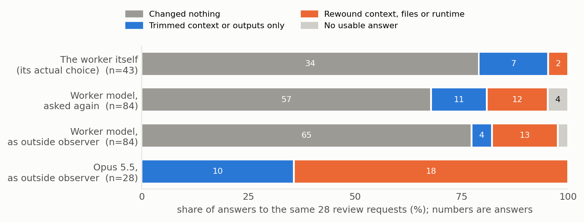

# Will a coding agent rewind itself? A stall-recovery pilot

A harness that saves a coding agent's files, runtime and context at every step, so a run can be restored at any step
and continued again. This pilot uses it on three real stalls to ask whether undoing work helps, and whether the agent
undoes anything itself.

> **This is a pilot.** It covers 3 stalls, 3 healthy checkpoints and 2 repeats per condition: 96 branches on
> 2026-11-03 and 12 follow-up branches on 2026-11-04, with one worker model, development settings and draft prompts.
> Every result below is a count from a few runs, not an estimate. It shows that the method works end to end and which
> questions deserve a full run. Read the [limitations](#limitations) before quoting any number.

## What holds up

1. **On one stall, restoring the run to three steps earlier changed the outcome.** On the production-planning stall,
   branches restored to three steps before the stall solved 5 of 7, and branches that continued from the stall solved
   0 of 7 (two-sided Fisher exact p = 0.021). This is one stall on one task, and the count pools the screen with the
   arms, which for this stall used different feedback lines. On the other two stalls the two are not distinguishable
   (ATRX 3/7 rewind vs 4/7 continue, heat-pump 2/7 vs 4/7).
2. **The agent almost never rewinds itself, and Opus reading the same request usually would.** In 24 one-shot reviews
   at the stalls, 12 of them told "This run looks stalled.", the agent rewound its context, files or runtime 0 times
   and changed nothing 20 times. With a review tool it could open at any time, 2 of 13 openings rewound. Asked again
   with the same requests, the same model rewound in 12 of 84 answers, and in 13 of 84 when asked as an outside
   observer. Opus 5.5 changed something at 28 of 28 requests and rewound at 18. This describes one worker model, draft
   prompts and very long review views. It does not show that declining to rewind was a mistake (see 3).
3. **Nothing here shows that a different decider solves more.** Executing Opus's recorded decisions solved 2 of 6
   branches, the same as the worker's own Ledger reviews (2 of 6). The any-time review tool solved 3 of 6, against 2
   of 6 for continue and 3 of 6 for forced rewind. At 6 branches per arm this is no evidence either way.



## What is only a hint

- **A failed attempt may carry over into a healthy run.** On the one informative healthy checkpoint (ATRX p60),
  inserting a real failed attempt together with its failure gave 0/2, against 2/2 untouched (Fisher exact p = 0.33).
  Neutral filler and stale output gave 2/2. A false success claim, the failed approach before its failure, and the
  failed run's leftover files gave 1/2 each. The other two checkpoints were uninformative: production p10 did not
  solve even untouched (0/2), and mvcc p20 solved 2/2 under every condition.
- **Reviewing a healthy run did no visible harm.** The Ledger review on the three healthy checkpoints solved as often
  as the untouched control (0/2, 2/2 and 2/2 on both sides).
- **Ledger review against context review cannot be compared yet.** They solved 2/6 and 1/6, but 20 of the 24 reviews
  changed nothing, so both arms mostly ran as continue.
- **Stall type.** The three stalls are one each of stuck, under-commit and over-commit, so nothing can be said about
  whether the type predicts when rewinding helps.

## Start here

| If you want to know | Look at |
|---|---|
| What happened in each branch | [`data/branches.csv`](data/branches.csv), one row per branch |
| What each chooser picked for the same review request | [`data/observer_choices.csv`](data/observer_choices.csv) |
| What the agent decided in its one-shot reviews, and why | [`data/review_decisions.json`](data/review_decisions.json), with reasoning excerpts |
| Which stalls were screened and admitted | [`data/screen.csv`](data/screen.csv) |
| Where every count in this README comes from | [`analysis/out/tables.md`](analysis/out/tables.md), rebuilt by [`analysis/make_tables.py`](analysis/make_tables.py) |
| The figures | [`figures/`](figures), rebuilt by [`analysis/make_figures.py`](analysis/make_figures.py) |
| The plan this pilot leads to | [What's next](#whats-next) |
| The write-up | [`paper/main.pdf`](paper/main.pdf), written 2026-11-03 with a paragraph on the follow-ups added; its next steps are replaced by the plan here |
| How a branch is restored and run | [`code/src/trajectory_retention/experiments/branch_v2.py`](code/src/trajectory_retention/experiments/branch_v2.py) |
| How arms and spec sets are built and run | [`code/configs/v2/arms_v2.py`](code/configs/v2/arms_v2.py), [`code/configs/v2/driver_v2.py`](code/configs/v2/driver_v2.py) |
| The review prompts | [`code/configs/v2/prompts/`](code/configs/v2/prompts) |

## Results

All cells are branches solved / branches run. Every table below is copied from `analysis/out/tables.md`.

### Continue vs forced rewind, screen and arms pooled

The arms all used the neutral feedback line ("The task is not complete yet. Continue working."). The screens of production-planning and atrx-vep-crispr used the count line ("Hidden tests still failing: N."), so pooling mixes the two lines for those stalls; the screen of heat-pump-warranty used the neutral line.

| Stall (type) | Stall point (step) | Forced rewind restores (step) | Steps undone | Screen feedback line | Continue: screen | Continue: arms (neutral line) | Continue pooled | Forced rewind: screen | Forced rewind: arms (neutral line) | Forced rewind pooled | Fisher exact p, two-sided |
|---|---|---|---|---|---|---|---|---|---|---|---|
| production-planning (stuck) | 20 | 17 | 3 | count line | 0/5 | 0/2 | 0/7 | 3/5 | 2/2 | 5/7 | 0.021 |
| atrx-vep-crispr (under-commit) | 100 | 91 | 9 | count line | 4/5 | 0/2 | 4/7 | 2/5 | 1/2 | 3/7 | 1.000 |
| heat-pump-warranty (over-commit) | 70 | 68 | 2 | neutral line | 2/5 | 2/2 | 4/7 | 2/5 | 0/2 | 2/7 | 0.592 |


### Main test: solved / branches, per stall and arm

| Stall (type) | Screen: continue | Screen: rewind | Continue | Ledger review | Context review | Forced rewind | Ledger read-only | Context read-only | Any-time review (arm 7, follow-up) | Ledger review, Opus decides (follow-up) |
|---|---|---|---|---|---|---|---|---|---|---|
| production-planning (stuck) | 0/5 | 3/5 | 0/2 | 0/2 | 0/2 | 2/2 | 0/2 | 0/2 | 1/2 | 1/2 |
| atrx-vep-crispr (under-commit) | 4/5 | 2/5 | 0/2 | 0/2 | 0/2 | 1/2 | 0/2 | 0/2 | 0/2 | 0/2 |
| heat-pump-warranty (over-commit) | 2/5 | 2/5 | 2/2 | 2/2 | 1/2 | 0/2 | 1/2 | 2/2 | 2/2 | 1/2 |
| **All three** | | | 2/6 | 2/6 | 1/6 | 3/6 | 1/6 | 2/6 | 3/6 | 2/6 |

### What the review turn chose

| Where | Reviews | Changed nothing | Dropped context only | Rewound a channel | Rewound context or files |
|---|---|---|---|---|---|
| Stalls, neutral prompt | 12 | 11 | 1 | 0 | 0 |
| Stalls, told stalled | 12 | 9 | 2 | 1 | 0 |
| Healthy runs (harm test) | 6 | 4 | 2 | 0 | 0 |

Across the 24 one-shot reviews at stalls (12 with the neutral prompt, 12 told the run looks stalled): 20 of 24 changed nothing, 3 dropped context only, 1 rewound the outputs channel only, and 0 of 24 rewound context, files or runtime.


### Follow-up: any-time review (arm 7), every opening of the review

| Stall | Branches solved | Openings | Changed nothing | Trimmed context only | Rewound outputs only | Rewound context, files or runtime |
|---|---|---|---|---|---|---|
| production-planning | 1/2 | 3 | 0 | 1 | 0 | 2 |
| atrx-vep-crispr | 0/2 | 6 | 6 | 0 | 0 | 0 |
| heat-pump-warranty | 2/2 | 4 | 4 | 0 | 0 | 0 |
| **All three** | 3/6 | 13 | 10 | 1 | 0 | 2 |

2 of 13 openings rewound context, files or runtime (production-planning).

### Who rewinds: every answer to the same review requests

28 review requests (25 at stalls, 3 at healthy checkpoints): the 30 one-shot review turns share 15 requests, and each of the 13 any-time openings is its own request.

**All requests**

| Who answers | Answers | Changed nothing | Trimmed context only | Rewound outputs only | Rewound context, files or runtime | No usable answer | Share that rewound | Answers with a call error |
|---|---|---|---|---|---|---|---|---|
| The worker itself (its actual choice) | 43 | 34 | 6 | 1 | 2 | 0 | 5% (2/43) | 0/43 |
| Worker model, asked again with the same request | 84 | 57 | 11 | 0 | 12 | 4 | 14% (12/84) | 17/84 |
| Worker model, asked as an outside observer | 84 | 65 | 4 | 0 | 13 | 2 | 15% (13/84) | 8/84 |
| Opus 5.5, asked as an outside observer | 28 | 0 | 10 | 0 | 18 | 0 | 64% (18/28) | 8/28 |

**Requests at stalls**

| Who answers | Answers | Changed nothing | Trimmed context only | Rewound outputs only | Rewound context, files or runtime | No usable answer | Share that rewound | Answers with a call error |
|---|---|---|---|---|---|---|---|---|
| The worker itself (its actual choice) | 37 | 30 | 4 | 1 | 2 | 0 | 5% (2/37) | 0/37 |
| Worker model, asked again with the same request | 75 | 54 | 7 | 0 | 10 | 4 | 13% (10/75) | 16/75 |
| Worker model, asked as an outside observer | 75 | 60 | 1 | 0 | 12 | 2 | 16% (12/75) | 7/75 |
| Opus 5.5, asked as an outside observer | 25 | 0 | 7 | 0 | 18 | 0 | 72% (18/25) | 7/25 |

**Requests at healthy checkpoints**

| Who answers | Answers | Changed nothing | Trimmed context only | Rewound outputs only | Rewound context, files or runtime | No usable answer | Share that rewound | Answers with a call error |
|---|---|---|---|---|---|---|---|---|
| The worker itself (its actual choice) | 6 | 4 | 2 | 0 | 0 | 0 | 0% (0/6) | 0/6 |
| Worker model, asked again with the same request | 9 | 3 | 4 | 0 | 2 | 0 | 22% (2/9) | 1/9 |
| Worker model, asked as an outside observer | 9 | 5 | 3 | 0 | 1 | 0 | 11% (1/9) | 1/9 |
| Opus 5.5, asked as an outside observer | 3 | 0 | 3 | 0 | 0 | 0 | 0% (0/3) | 1/3 |

Opus changed something at 28 of 28 requests. 11 of its 28 answers were made from a copy of the request in which the word "reasoning" was replaced by "notes" (column input_variant).
The 168 extra worker-model answers cost $3.93; none of these answers was executed.

### Follow-up: reviews told "This run looks stalled."

| Stall | Ledger review (pilot) | Ledger review (told stalled) | Context review (pilot) | Context review (told stalled) |
|---|---|---|---|---|
| production-planning | 0/2 | 0/2 | 0/2 | 0/2 |
| atrx-vep-crispr | 0/2 | 0/2 | 0/2 | 0/2 |
| heat-pump-warranty | 2/2 | 1/2 | 1/2 | 1/2 |

### Injection test: solved / branches on healthy checkpoints

| Injected content | production p10 | ATRX p60 | mvcc p20 |
|---|---|---|---|
| None (control) | 0/2 | 2/2 | 2/2 |
| Small neutral filler | 1/2 | 2/2 | 2/2 |
| Large neutral filler | 0/2 | -- | -- |
| Stale output | 0/2 | 2/2 | 2/2 |
| False success claim | 0/2 | 1/2 | 2/2 |
| Failed approach, before failure | 0/2 | 1/2 | 2/2 |
| Failed approach, failure shown | 0/2 | 0/2 | 2/2 |
| Leftover files (debris) | 0/2 | 1/2 | -- |

ATRX p60, failed approach with its failure shown against the control: 0/2 vs 2/2, Fisher exact p = 0.33 (two-sided).

The production and mvcc checkpoints are uninformative. Production did not solve under the pilot's caps, even
untouched, and mvcc's workspace already passed the tests. `--` means no suitable excerpt existed.


### Harm test: Ledger review on healthy checkpoints

| Healthy checkpoint | Ledger review solved | No-injection control solved |
|---|---|---|
| production p10 | 0/2 | 0/2 |
| ATRX p60 | 2/2 | 2/2 |
| mvcc p20 | 2/2 | 2/2 |

Cost: $23.61 for 108 branches (followup_anytime_review $2.32, followup_opus_decides $1.32, followup_stalled_told $2.70, pilot_harm $1.32, pilot_injection $8.26, pilot_main $7.68).

## How it works

- **Worker:** DeepSeek V4.1 Flash via OpenRouter, in a mini-SWE-agent-style bash loop, on Terminal-Bench-style tasks
  graded by hidden tests. A failed submission is answered only with "The task is not complete yet. Continue working."
- **Checkpoints:** after every step the harness stores the workspace files (W), the runtime outside the workspace (R),
  the context (H) and the command outputs in the context (O). Any branch can restore any of them from any earlier step
  in a fresh container.
- **Stall judge:** GPT-6.1 Terra checks each run every 10 steps with 3 votes. It marks a stall with its onset step and
  one of three types: stuck, under-commit or over-commit.
- **Screen:** each stall gets 5 continue branches and 5 forced rewinds to the onset. It is admitted if some branch
  solves it and continue does not solve all five.
- **Ledger:** Terra labels every step up to the stall, splitting it into units (claims, observations, ideas, actions)
  and linking each unit to what it rests on.
- **Six arms:**
  1. continue
  2. Ledger review: one turn with a `review_decision` tool that can rewind each of W/R/H/O, drop units, keep units, or
     change nothing
  3. context review: the same, over the plain context
  4. forced rewind of all four parts to the onset
  5. Ledger read-only: the Ledger returned as notes, with no tool
  6. context read-only: the plain context returned as notes, with no tool
- **Follow-ups on the same three stalls:**
  - reviews that open with "This run looks stalled."
  - any-time review (arm 7): the worker continues from the stall with a tool that opens the Ledger review whenever it
    chooses, as often as it chooses
  - observer choices: each review request is also answered by the worker model again, by the worker model asked as an
    outside observer, and by Opus 5.5 asked as an outside observer. These answers are recorded, not executed.
  - Opus decides: the Ledger review arm rerun with Opus's recorded decision executed in place of the worker's
- **Injection test:** real excerpts from a failed run of the same task are inserted into healthy checkpoints. The
  excerpts were reviewer-selected from worker-visible logs.
- **Harm test:** the Ledger review run on healthy checkpoints.
- **Before any paid run**, every branch spec ran through the real engine with a scripted model: real restores, real
  review turns, real injection splices, real grading, and zero model calls.

## What's next

*Planned, not run. Criticism of this plan is the most useful thing a reader can send.*

**Question.** Where along a run does the chance of solving drop, and when it drops, is the damage in the files or in
the context?

**Why this.** The one clear result above came from continuing the same run from two nearby steps, not from any review
arm. The plan does that at several points of every run, instead of at one point picked by a judge.

**What runs.**

1. 5 fresh runs on each of the 11 tasks already set up in the harness (hidden tests kept outside the agent's
   container, restore checked per task), all under one feedback line.
2. Continue 5 times from about 4 checkpoints per failed run and 3 per solved run. This gives the chance of solving
   from each point.
3. At the largest drop in each run: the earlier files with the later context, and the later files with the earlier
   context, 6 times each.
4. A comparison of the measured drop with the step the stall judge names as the onset.
5. A small trained predictor of the chance of solving from the run so far, tested on tasks it was not trained on
   (leave one task out).

**What each outcome would mean.**

- Many failed runs lose their chance over one short stretch: rewinding is worth building, and the measured drop says
  where to rewind to.
- Most failed runs never had a real chance, or kept a moderate chance throughout: recovery at stalls can only help a
  minority, and a plain rerun does as well.
- Earlier files alone restore the chance: the damage is in the workspace. Earlier context alone restores it: the damage
  is in what the agent has read and written. Only both together: neither kind of undo is enough alone.
- The judge's onset comes later than the measured drop: rewind points chosen by a judge start too late.

**Guesses, written down before running.** Failed runs split roughly in thirds between never solvable, lost at one
stretch, and unlucky. The drop comes after the first fifth of the run (Failure as a Process, below, reports from
annotation that failures usually begin in the first few steps). Files or context: no guess.

## Related work

- **AgentRewind** ([arXiv 2608.14380](https://arxiv.org/abs/2608.14380)): gives the agent rewind tools and lets it
  choose when to use them.
- **Rollback-Induced Reflection** ([arXiv 2609.18304](https://arxiv.org/abs/2609.18304)): rewinds the environment and
  keeps a reflection.
- **Fork-and-Flush** ([arXiv 2610.07447](https://arxiv.org/abs/2610.07447)): concurrent work that forks branches with a
  fresh context on a fixed schedule.
- **Our earlier study** ([de-re-composev1](https://github.com/H0tP0cket/de-re-composev1)): found that removing labelled
  parts of a stalled context mostly cost what it removed.
- **ReplayRCA** ([arXiv 2610.41025](https://arxiv.org/abs/2610.41025)): scores failure diagnoses by intervention:
  restore the state before a chosen step, replace the action, continue, and compare with a placebo replay. Synthetic
  back-office environment, 13 models as diagnosers.
- **Pakhomov and Nijkamp** ([arXiv 2611.05650](https://arxiv.org/abs/2611.05650)): argue that claims attributing an
  agent's failure to its history need executed counterfactuals from states whose restoration has been measured.
- **Causal Agent Replay** ([arXiv 2606.08275](https://arxiv.org/abs/2606.08275)): attributes a failure to a step by
  intervening and re-executing K times; validated on synthetic causal models.
- **Failure as a Process** ([arXiv 2607.09510](https://arxiv.org/abs/2607.09510)): manual annotation of 1,794
  Terminal-Bench trajectories; reports that failures usually begin in the first few steps.
- **Dependable Long-Horizon LLM Agents** ([arXiv 2611.13254](https://arxiv.org/abs/2611.13254)): annotation of 95
  failed multi-agent runs; evidence against the error was present in 72% and not acted on in 88% of those.
- **When Harnesses Lose the Signal** ([arXiv 2610.00372](https://arxiv.org/abs/2610.00372)): compares with and without
  recovery from the same state on ALFWorld and trains a router for when to intervene.
- **SPROUT** ([arXiv 2610.14405](https://arxiv.org/abs/2610.14405)): snapshots files and context each turn and resumes
  failed rollouts from intermediate states, for inference and RL training.
- **RippleCP** ([arXiv 2610.09088](https://arxiv.org/abs/2610.09088)): measures how much recovery time a checkpoint
  saves on 12 SWE-bench Verified tasks.
- **DeepRewind** ([arXiv 2609.36344](https://arxiv.org/abs/2609.36344)): a typed graph of claims and evidence with
  dependency-aware rollback for deep-research agents.
- **Evolving Agent Teams** ([arXiv 2610.36848](https://arxiv.org/abs/2610.36848)): finds that coding agents converge to
  local optima on GPU kernel optimization, and uses a supervisor that diagnoses each local optimum and restructures a
  team of agents.
- **Snapshots as search states** ([Daytona blog post](https://www.daytona.io/dotfiles/snapshots-as-search-states-go-explore-with-daytona)):
  branches from sandbox snapshots of failed Terminal-Bench runs with a fresh context. Retrying from scratch solved 17
  of 25 task-seed pairs and branching solved 6 of 25. On one task whose progress lived in a SQLite database, full
  snapshots solved 4 of 5 against 0 of 5. This is the closest existing measurement to step 3 of the plan above.

The descriptions of the ten papers from ReplayRCA through Evolving Agent Teams are taken from their abstracts, not
from a full reading.

## Limitations

- Three stalls and two repeats per cell.
- For production-planning and ATRX the screen used the count feedback line and the arms the neutral line. Continue on
  ATRX went from 4/5 in the screen to 0/2 in the arms, so the wording may matter as much as the arm. The pooled
  production count under "What holds up" mixes the two lines; within the arms alone it is 0/2 for continue and 2/2
  for forced rewind. The heat-pump screen used the neutral line, like the arms.
- Two of three healthy checkpoints were uninformative, so the injection hint rests on one checkpoint.
- The review views were 0.9–1.2 million characters long, and no failed submission was visible at review time. Both
  favour changing nothing.
- One worker model, draft prompts, and a judge and labeller from one other model family.
- Observer choices were recorded, not executed, except Opus's in the Opus-decides rerun. Some answers had a call error,
  such as naming a unit that does not exist (17 of 84 when the worker model was asked again, 8 of 84 as outside
  observer, 8 of 28 for Opus); they are counted by what they asked for. 4 answers when the worker model was asked
  again and 2 as outside observer were unusable. 11 of the 28 Opus answers were made from a copy of the request in
  which the word "reasoning" was replaced by "notes".

## Data

- **`data/branches.csv`:** one row per branch, covering set, arm, stall type, solved, best and final share of tests
  passed, submissions, end reason, cost, tokens, and what the review chose. Sets: `pilot_main`, `pilot_injection`,
  `pilot_harm`, `followup_stalled_told`, `followup_anytime_review` (arm 7) and `followup_opus_decides`. For arm 7 the
  review columns sum over every opening of the review in that branch; for Opus-decides they describe Opus's decision.
- **`data/observer_choices.csv`:** one row per review request, chooser and answer, with the decision in short form
  (for example `C91 drop2 keep2` is "rewind context to step 91, drop 2 units, keep 2") and what it rewound. `valid`
  is false when the call had an error, and `input_variant` marks the Opus answers made from the reworded copy
  described under limitations. Decisions only, no text.
- **`data/review_decisions.json`:** the worker's one-shot review decisions, with the first 1,500 characters of its
  reasoning.
- **`data/screen.csv`:** the stall screen.

Full trajectories and hidden tests are not included.

## Reproduce the tables and figures

```bash
python analysis/make_tables.py            # standard library only -> analysis/out/tables.md, paper/tables/*.tex
pip install matplotlib==3.9.2
python analysis/make_figures.py           # -> figures/*.pdf, figures/*.png
cd paper && tectonic -X compile main.tex  # -> paper/main.pdf
```

`analysis/export_from_study.py` is the script that produced `data/` from the original study folders. It needs those
folders and is included for provenance.

## Rerun the branches

`code/` holds the engine as it ran on 2026-11-03 (package `trajectory_retention`, the configs in `code/configs/v2`, and
the prompts in `code/configs/v2/prompts`). The code for the 2026-11-04 follow-ups is not included yet:
`experiments/anytime_review.py`, `configs/v2/anytime_specset.py`, `configs/v2/observer_choices.py`,
`configs/v2/opus_decider_specset.py`, the engine checks `m15_anytime_review.py` and `m16_external_decision.py`, the
prompt `anytime.units-v1-draft.md`, and later changes to `branch_v2.py`, `runner.py`, `agent.py`, `labeller.py`,
`codex_subscription.py` and `record_attachment.py`. A rerun needs:

- Docker (we used colima on Apple silicon), Python 3.12 and `uv sync` in `code/`;
- an OpenRouter key for the worker, and a Codex subscription for the GPT-6.1 Terra judge and labeller;
- the source runs and their stored checkpoints. These are not included because of their size; the branch specs point
  at them.

Entry points:

- **Arms and spec sets:** `code/configs/v2/arms_v2.py`
- **Driver** (resumable, parallel): `code/configs/v2/driver_v2.py`
- **Branch engine:** `code/src/trajectory_retention/experiments/branch_v2.py`
- **Zero-cost dry run of any spec set:** `code/configs/v2/pilot_dryrun.py`
- **Review prompts:** `code/configs/v2/prompts/review.units-v1-draft.md` (neutral) and
  `review.units-v1-stalled-draft.md` (opens with "This run looks stalled.")
