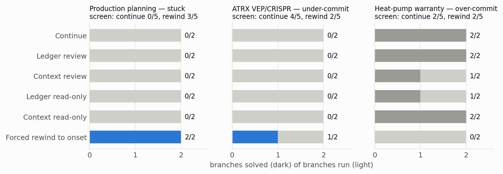
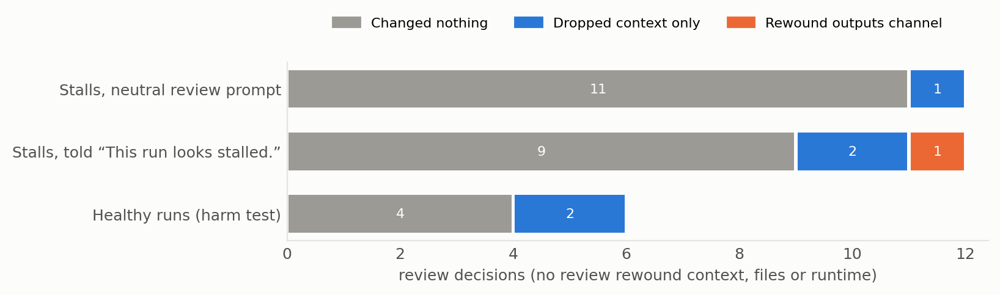
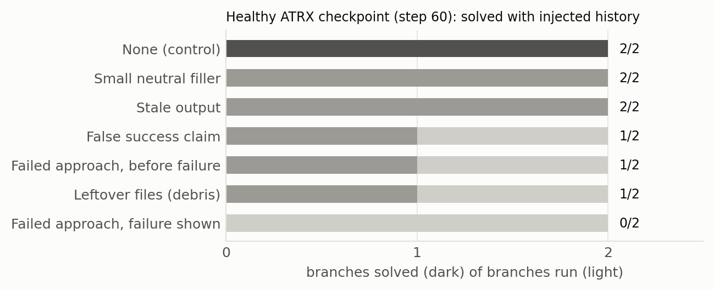

# Will a coding agent rewind itself? A stall-recovery pilot

> **This is a pilot.** It covers 3 stalls, 3 healthy checkpoints and 2 repeats per condition (96 branches in total),
> with one worker model, development settings and draft prompts. Every result below is a count from a few runs, not an
> estimate. It shows that the method works end to end and which questions deserve a full run. Read the
> [limitations](#limitations) before quoting any number.

Write-up: [`paper/main.pdf`](paper/main.pdf). Data: [`data/`](data). Everything below is rebuilt from `data/` by the
two scripts in [`analysis/`](analysis).

## What we found

1. **Rewinding to where the stall began helped two of three stalls and hurt the third.** On a *stuck* stall, both forced
   rewinds solved while all ten other branches ended at 90% of hidden tests (one of them never submitted). On an *under-commit* stall, one of two
   forced rewinds solved while every other branch stayed at the source run's 56%. On an *over-commit* stall, continuing
   solved 2/2 and the forced rewind 0/2.
2. **The agent never rewound itself.** In 24 review turns at the stalls it never rewound its context, files or
   runtime. That includes 12 turns where the review opened with "This run looks stalled." It changed nothing 20 times
   and only trimmed its context in the rest. Its reasons were consistent: no failed submission was in view, rewinding
   looked like losing work, and changing nothing looked safe.
3. **Failed attempts are contagious.** One healthy run solves 2/2 untouched. Inserting a real failed attempt together
   with its failure dropped it to 0/2, and both branches settled at the donor's 56%. Neutral filler and stale output did
   nothing. A false success claim, the failed approach before its failure, and the failed run's leftover file each cost
   one solve out of two.
4. **Reviewing a healthy run did no harm**: the review solved exactly as often as untouched controls.

Total cost: **$19.97** for 96 branches.







## Results tables

All cells are branches solved / branches run.

**Main test.** The screen used the earlier feedback line ("Hidden tests still failing: N."); the arms used the current
one ("The task is not complete yet. Continue working.").

| Stall (type) | Screen: continue | Screen: rewind | Continue | Ledger review | Context review | Forced rewind | Ledger read-only | Context read-only |
|---|---|---|---|---|---|---|---|---|
| production-planning (stuck) | 0/5 | 3/5 | 0/2 | 0/2 | 0/2 | **2/2** | 0/2 | 0/2 |
| atrx-vep-crispr (under-commit) | 4/5 | 2/5 | 0/2 | 0/2 | 0/2 | **1/2** | 0/2 | 0/2 |
| heat-pump-warranty (over-commit) | 2/5 | 2/5 | 2/2 | 2/2 | 1/2 | 0/2 | 1/2 | 2/2 |
| All three | | | 2/6 | 2/6 | 1/6 | 3/6 | 1/6 | 2/6 |

**Review decisions**

| Where | Reviews | Changed nothing | Trimmed context only | Rewound outputs only | Rewound context, files or runtime |
|---|---|---|---|---|---|
| Stalls, neutral prompt | 12 | 11 | 1 | 0 | 0 |
| Stalls, told "This run looks stalled." | 12 | 9 | 2 | 1 | 0 |
| Healthy runs (harm test) | 6 | 4 | 2 | 0 | 0 |

**Injection test**

| Inserted content | production p10 | ATRX p60 | mvcc p20 |
|---|---|---|---|
| None (control) | 0/2 | 2/2 | 2/2 |
| Small neutral filler | 1/2 | 2/2 | 2/2 |
| Large neutral filler | 0/2 | – | – |
| Stale output | 0/2 | 2/2 | 2/2 |
| False success claim | 0/2 | 1/2 | 2/2 |
| Failed approach, before failure | 0/2 | 1/2 | 2/2 |
| Failed approach, failure shown | 0/2 | **0/2** | 2/2 |
| Leftover files (debris) | 0/2 | 1/2 | – |

The production and mvcc checkpoints are uninformative. Production never solved under the pilot's caps, even
untouched, and mvcc's workspace already passed the tests. A dash means no suitable excerpt existed.

## How it works

- **Worker:** DeepSeek V4.1 Flash via OpenRouter, in a mini-SWE-agent-style bash loop, on Terminal-Bench-style tasks
  graded by hidden tests. A failed submission is answered only with "The task is not complete yet. Continue working."
- **Checkpoints:** after every step the harness stores four parts. Any branch can restore any of them from any
  earlier step in a fresh container.
  - the workspace files (W)
  - the runtime outside the workspace (R)
  - the context (H)
  - the command outputs in the context (O)
- **Stall judge:** GPT-6.1 Terra checks each run every 10 steps with 3 votes. It marks a stall with its onset step and
  one of three types: stuck, under-commit or over-commit.
- **Screen:** each stall gets 5 continue branches and 5 forced rewinds to the onset. It is admitted if some branch
  solves it and continue does not solve all five.
- **Ledger:** Terra labels every step up to the stall, splitting it into units (claims, observations, ideas, actions)
  and linking each unit to what it rests on.
- **Six arms:**
  1. continue
  2. Ledger review: one turn with a `review_decision` tool that can rewind each of W/R/H/O, drop units, keep units, or
     change nothing
  3. context review: the same, over the plain context
  4. forced rewind of all four parts to the onset
  5. Ledger read-only: the Ledger returned as notes, with no tool
  6. context read-only: the plain context returned as notes, with no tool
- **Injection test:** real excerpts from a failed run of the same task are inserted into healthy checkpoints. The
  excerpts were reviewer-selected from worker-visible logs.
- **Harm test:** the Ledger review run on healthy checkpoints.
- **Before any paid run**, every branch spec ran through the real engine with a scripted model: real restores, real
  review turns, real injection splices, real grading, and zero model calls.

## Reproduce the tables and figures

```bash
python analysis/make_tables.py            # standard library only -> analysis/out/tables.md, paper/tables/*.tex
pip install matplotlib==3.9.2
python analysis/make_figures.py           # -> figures/*.pdf, figures/*.png
cd paper && tectonic -X compile main.tex  # -> paper/main.pdf
```

`analysis/export_from_study.py` is the script that produced `data/` from the original study folders. It needs those
folders and is included for provenance.

## Rerun the branches

`code/` holds the engine exactly as it ran (package `trajectory_retention`, the configs in `code/configs/v2`, and the
prompts in `code/configs/v2/prompts`). A rerun needs:

- Docker (we used colima on Apple silicon), Python 3.12 and `uv sync` in `code/`;
- an OpenRouter key for the worker, and a Codex subscription for the GPT-6.1 Terra judge and labeller;
- the source runs and their stored checkpoints. These are not included because of their size; the branch specs point
  at them.

Entry points:

- **Arms and spec sets:** `code/configs/v2/arms_v2.py`
- **Driver** (resumable, parallel): `code/configs/v2/driver_v2.py`
- **Branch engine:** `code/src/trajectory_retention/experiments/branch_v2.py`
- **Zero-cost dry run of any spec set:** `code/configs/v2/pilot_dryrun.py`
- **Review prompts:** `code/configs/v2/prompts/review.units-v1-draft.md` (neutral) and
  `review.units-v1-stalled-draft.md` (opens with "This run looks stalled.")

## Data

- **`data/branches.csv`:** one row per branch, covering arm, stall type, solved, best and final share of tests passed,
  submissions, end reason, cost, tokens, and what the review chose.
- **`data/review_decisions.json`:** every review decision, with the first 1,500 characters of the agent's reasoning.
- **`data/screen.csv`:** the stall screen.

Full trajectories and hidden tests are not included.

## Limitations

- Three stalls and two repeats per cell.
- The screen and the arms used different feedback lines. Continue on ATRX went from 4/5 in the screen to 0/2, so the
  wording may matter as much as the arm.
- Two of three healthy checkpoints were uninformative, so the injection result rests on one checkpoint.
- The review views were 0.9–1.2 million characters long, and no failed submission was visible at review time. Both
  favour changing nothing.
- One worker model, draft prompts, and a judge and labeller from one other model family.

## Next steps

1. **More stalls under one feedback wording.** Six more judge-confirmed stalls and three long unsolved runs are queued.
   Running them would test whether the stall type predicts whether rewinding helps.
2. **An outside rewind decision.** The agent won't rewind itself, and a forced rewind can rescue a real stall. So the
   next arm is a controller that decides whether and where to rewind from the Ledger and the workspace: first as
   rules, then as a contextual bandit trained on branch outcomes.
3. **Ledger branching on live runs.** Detect stalls during a run and branch from them right away.
4. **Separating failed runs of the same task as an RL signal.** Paired branches from one stall that differ only in what
   was undone give a clean failing-versus-recovering contrast. That contrast can serve as a reward or preference
   signal.
5. **A larger agent managing recovery.** A stronger model reads the Ledger and runs a smaller worker's recovery. Its
   decisions and their outcomes become data for distilling a small Ledger builder and, further off, for updating the
   worker's weights.
6. **Better review conditions** to tell apart why the agent didn't rewind: review after a visible failed submission,
   a short Ledger summary instead of the full run, and the "stalled" sentence crossed with both.

## Related work

- **AgentRewind** ([arXiv 2608.14380](https://arxiv.org/abs/2608.14380)): gives the agent rewind tools and lets it
  choose when to use them.
- **Rollback-Induced Reflection** ([arXiv 2609.18304](https://arxiv.org/abs/2609.18304)): rewinds the environment and
  keeps a reflection.
- **Fork-and-Flush** ([arXiv 2610.07447](https://arxiv.org/abs/2610.07447)): concurrent work that forks branches with a
  fresh context on a fixed schedule.
- **Our earlier study** ([de-re-composev1](https://github.com/H0tP0cket/de-re-composev1)): found that removing labelled
  parts of a stalled context mostly cost what it removed.
